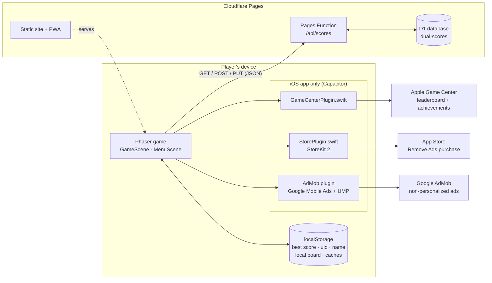
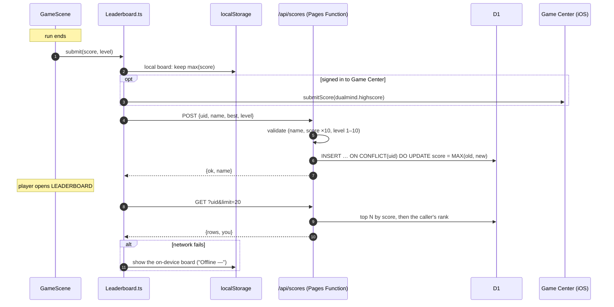
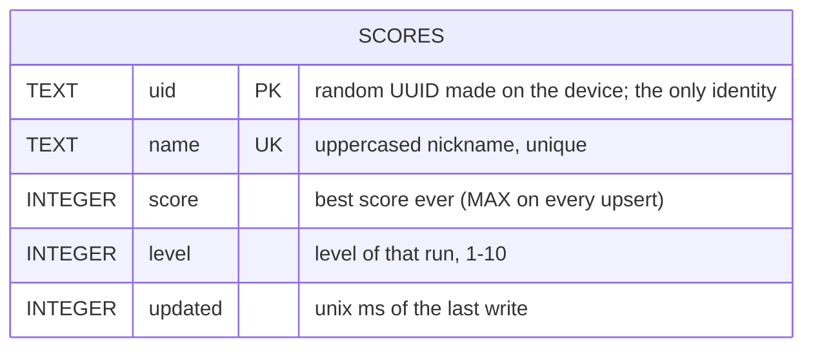
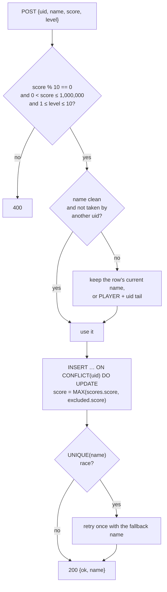
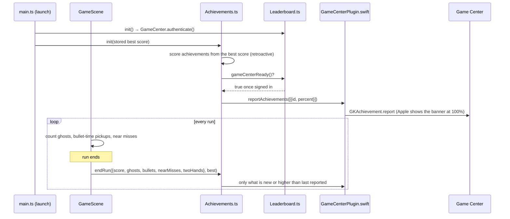
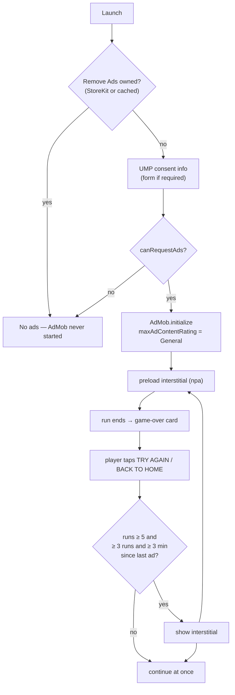

# DUAL

A two-thumb reflex arcade game: two dots, two lanes, endless gates. Built with
Phaser 3 + TypeScript + Vite. It ships as a web game / PWA at
<https://dual-game.pages.dev> and as an iOS app ("DUAL Mind") through a
Capacitor shell.

- [Run it](#run-it)
- [How the pieces fit](#how-the-pieces-fit)
- [Leaderboard](#leaderboard)
- [Database](#database)
- [Game Center achievements](#game-center-achievements)
- [Ads and Remove Ads (iOS)](#ads-and-remove-ads-ios)
- [Privacy](#privacy)
- [Releasing](#releasing)

Code-level conventions for AI agents and contributors live in
[AGENTS.md](AGENTS.md).

## Run it

```bash
bun install
bun run dev          # Vite on :3000 — uses the local (on-device) leaderboard
bun run build        # production web build → dist/
```

Dev-only switches:

| URL / env | Effect |
|---|---|
| `?ads` | Fakes the iOS ads + store in the browser: Settings shows ADS / REMOVE ADS, and a 1.5 s grey "TEST AD" overlay stands in for an interstitial (same frequency rules). The fake purchase succeeds after 0.7 s. |
| `VITE_LB_API=http://localhost:8788/api/scores` | Point `bun run dev` at a local Pages Function (`bunx wrangler pages dev dist --port 8788`). |
| `VITE_LB_API=local` | Force the on-device board in any build. |

`bun run dev` never writes to the live board unless `VITE_LB_API` says so.

## How the pieces fit



| Module | Job |
|---|---|
| `src/engine/Leaderboard.ts` | Global board client (Cloudflare), offline fallback to the on-device board, Game Center score mirror |
| `src/engine/Achievements.ts` | Decides which Game Center achievements a run earned and reports them |
| `src/engine/Store.ts` | Whether ads are removed; buy / restore through StoreKit |
| `src/engine/Ads.ts` | Consent, frequency rules, showing an interstitial at a break |
| `functions/api/scores.ts` | The leaderboard API (validation, upsert, ranking) |
| `ios/App/App/*Plugin.swift` | App-local Capacitor plugins: Game Center and StoreKit |

## Leaderboard

One global board shared by both control modes. Each device is one row,
identified only by a random UUID it generates on first launch. Only a device's
best score is kept.



- **Best, not latest:** the client always sends `max(this run, device best)`,
  so runs played offline catch up on the next online game. The server keeps
  `MAX(old, new)` as well, so a worse run can never lower a row.
- **Names:** players set a nickname on the leaderboard screen; it's uppercased
  and stripped to `A–Z 0–9 space` (accents folded: "Lukáš" → `LUKAS`),
  3–14 characters, and checked against a leetspeak-aware profanity list on both
  client and server. Names are unique. A rename to a taken name gets
  `409 name_taken`. A score submitted under a taken or blocked name is still
  stored, under the device's previous name or `PLAYER` + the last 6 uid chars.
- **Cheat resistance** is best-effort: scores must be positive multiples of 10
  up to 1,000,000 and levels 1–10. Any client score can be forged in principle.
- **CORS is `*`** because the iOS app runs at `capacitor://localhost`. The API
  sets no cookies and needs no auth.

API:

| Method | Body / query | Result |
|---|---|---|
| `GET /api/scores` | `?uid=<uid>&limit=<1-100>` | `{ rows: [{rank,name,score,you}], you: {rank,name,score} \| null }`; `you` is filled when the caller is outside the top N |
| `POST /api/scores` | `{ uid, name, score, level }` | `{ ok, name }`, where `name` is the name actually stored |
| `PUT /api/scores` | `{ uid, name }` | `{ ok, name }`, or `409 name_taken` / `400 bad_name` |

## Database

Cloudflare D1 (SQLite), database `dual-scores`, bound to the Pages project as
`DB` in [`wrangler.toml`](wrangler.toml). Schema in [`migrations/`](migrations).



| Index | Purpose |
|---|---|
| `uid` primary key | One row per device; the upsert target |
| `idx_scores_score (score DESC)` | Top-N query |
| `idx_scores_name` unique | Rename check; stops two devices racing to one name |

How a write flows:



Working with it:

```bash
# first-time setup (creates the DB if needed, applies every migration)
./scripts/setup-leaderboard.sh

# apply a new migration to production
bunx wrangler d1 execute dual-scores --remote --file=migrations/000N_name.sql

# look at the board
bunx wrangler d1 execute dual-scores --remote \
  --command "SELECT name, score, level FROM scores ORDER BY score DESC LIMIT 20"

# remove one entry (privacy request) — needs the player's uid
bunx wrangler d1 execute dual-scores --remote --command "DELETE FROM scores WHERE uid = '<uid>'"
```

The Function deliberately logs no IP addresses. Free-tier D1 limits are far
above what this board needs.

## Game Center achievements

iOS only. Ten achievements worth 800 of Apple's 1,000 points. They were created
by [`scripts/setup-achievements.py`](scripts/setup-achievements.py); icons are
in [`store/achievements/`](store/achievements), drawn by `render.cjs`.

| ID (`dualmind.ach.…`) | Name | Earned by | Pts | Progress bar |
|---|---|---|---|---|
| `warmup` | Warm-up | Score 500 | 25 | yes |
| `level3` | Level 3 | Reach level 3 (2,000) | 50 | yes |
| `level5` | Level 5 | Reach level 5 (4,000) | 75 | yes |
| `level7` | Level 7 | Reach level 7 (6,000) | 100 | yes |
| `level10` | Level 10 | Reach level 10 (9,000) | 100 | yes |
| `beyond` | Beyond *(hidden)* | Score 10,000 | 100 | no, any progress would reveal it |
| `ghosthunter` | Ghost Hunter | Collect 5 ghosts in one run | 100 | no |
| `slowmotion` | Slow Motion | Grab bullet time 3 times in one run | 75 | no |
| `razorsedge` | Razor's Edge | 10 near misses in one run | 75 | no |
| `ambidextrous` | Ambidextrous | Reach level 5 in TWO HANDS | 100 | no |



- Reports go out **at the end of a run**, never mid-run, so Apple's banner
  never covers the play field.
- Level *n* starts at (n − 1) × 1,000 points; level achievements use the
  device's best score, so players who already had a high score get them on
  the first launch of 1.1.
- Game Center keeps the highest percentage ever reported. `localStorage`
  key `dual_ach` remembers what was sent, so nothing is re-sent needlessly.
- Near misses only count while the player holds no ghost charge (that's when
  the game detects them).
- Not signed in to Game Center? Nothing is reported or cached, and it is tried
  again next launch / run.

## Ads and Remove Ads (iOS)

Every level is free for everyone. The free iOS app shows an occasional
full-screen ad; a one-time purchase, **Remove Ads**
(`com.lukaschylik.dualmind.fullgame`, $0.95 / €0.95 / 25 Kč, Family Sharing on),
turns them off for good. The web build has no ads and sells nothing.

The product ID still says `fullgame` because 1.1 sold the same purchase as
"Full Game" (levels 6–10 behind a paywall at 5,000 points). 1.2 dropped the
paywall; anyone who bought it in 1.1 is simply ad-free.

**Ads are gentle by design** (`src/engine/Ads.ts`):

| Rule | Value |
|---|---|
| Format | Interstitial only, image (no video) — no banners, nothing during a run |
| When | Only when the player leaves the game-over card (TRY AGAIN / BACK TO HOME) |
| First ad | Not before the player has finished `FREE_RUNS` = 5 runs |
| Spacing | At least `RUNS_BETWEEN` = 3 runs **and** `MIN_GAP_MS` = 3 minutes since the last ad |
| Targeting | Always non-personalized (`npa`); no App Tracking Transparency prompt, no IDFA |
| Content | Max rating "General"; sensitive categories blocked in the AdMob console |
| Consent | Google UMP form before the first request where the law needs it (EEA, UK, CH); Settings → ADS → AD PRIVACY reopens it |



- **Ad unit:** set `VITE_ADMOB_INTERSTITIAL_IOS` when building for release.
  Without it the build requests Google's demo ads (`isTesting`), which is what
  TestFlight builds should do.
- **App ID:** the Xcode build setting `ADMOB_APP_ID` (feeds
  `GADApplicationIdentifier` in `Info.plist`); it defaults to Google's demo
  app ID.
- **Buying while ads are on:** `Store.subscribe` turns ads off immediately.
  Ask to Buy, Family Sharing and other devices arrive through
  `Transaction.updates`.
- **Restore:** Settings → ADS → RESTORE runs `AppStore.sync()`.
- `localStorage` keys: `dual_full` (cached "ads removed", name kept from
  1.1), `dual_runs` (finished runs), `dual_last_ad_run` (value of
  `dual_runs` at the last ad).

## Privacy

Anonymity is a design rule: no accounts, no email, no advertising ID, no
analytics, no tracking. The one exception to "no third parties" is Google
AdMob in the free iOS app, always non-personalized and never started for
players who removed ads. The leaderboard stores a random device UUID, a nickname, a best
score and a level; the server keeps no IP addresses. Game Center and in-app
purchases are handled by Apple under the player's Apple ID, and the app never
sees payment details. The App Store privacy answers for 1.2+ must declare the
data Google's SDK collects for advertising (not linked to identity, not used
for tracking). Policy: [`public/privacy/`](public/privacy/index.html).
Changing any of this means updating that page and the App Store privacy
answers together.

## Releasing

- **Web:** every push to `main` deploys to Cloudflare Pages, including
  `functions/`.
- **iOS:** [`scripts/publish-testflight.sh`](scripts/publish-testflight.sh)
  builds, archives and uploads with an App Store Connect API key
  (`ASC_KEY_PATH`, `ASC_KEY_ID`, `ASC_ISSUER_ID`). Bump
  `CURRENT_PROJECT_VERSION` (and `MARKETING_VERSION` for a new version) in
  `ios/App/App.xcodeproj` first.
- **App Store Connect setup scripts** (same env vars, safe to re-run; they use
  `scripts/asc.py`, which needs `pip install pyjwt cryptography`):
  - `python3 scripts/setup-achievements.py`
  - `python3 scripts/setup-full-game.py [--screenshot shot.png]` (creates the product; rename to "Remove Ads" in App Store Connect)
- New achievements and the in-app purchase go live only once they are attached
  to an app version that passes review.
