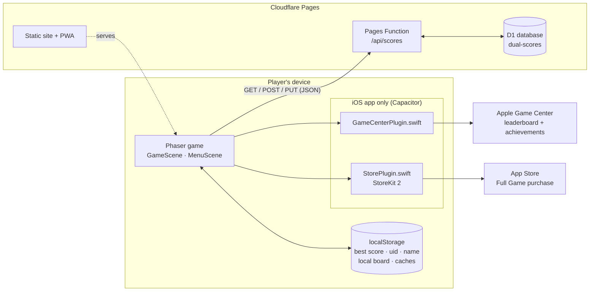
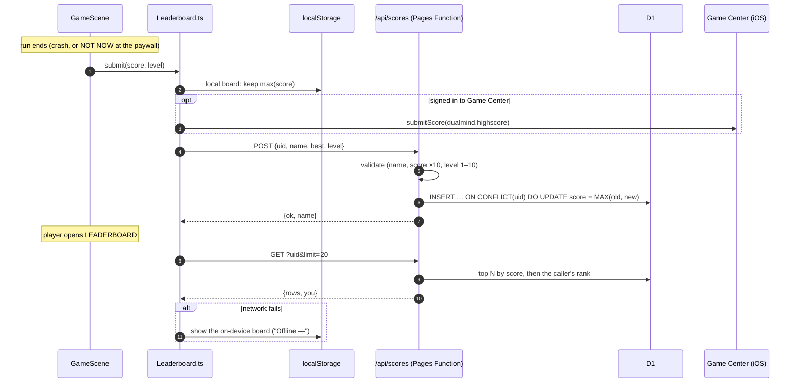
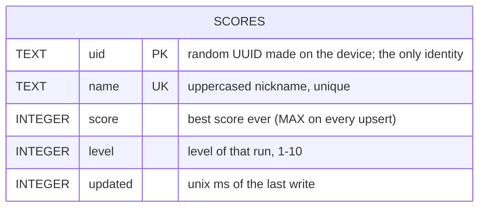
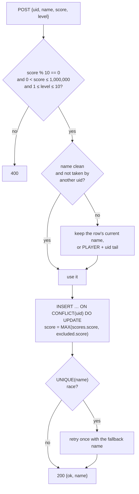
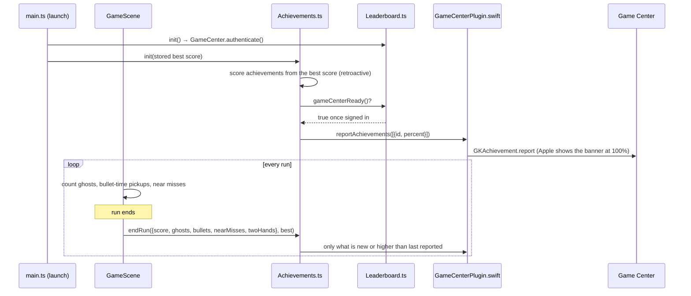
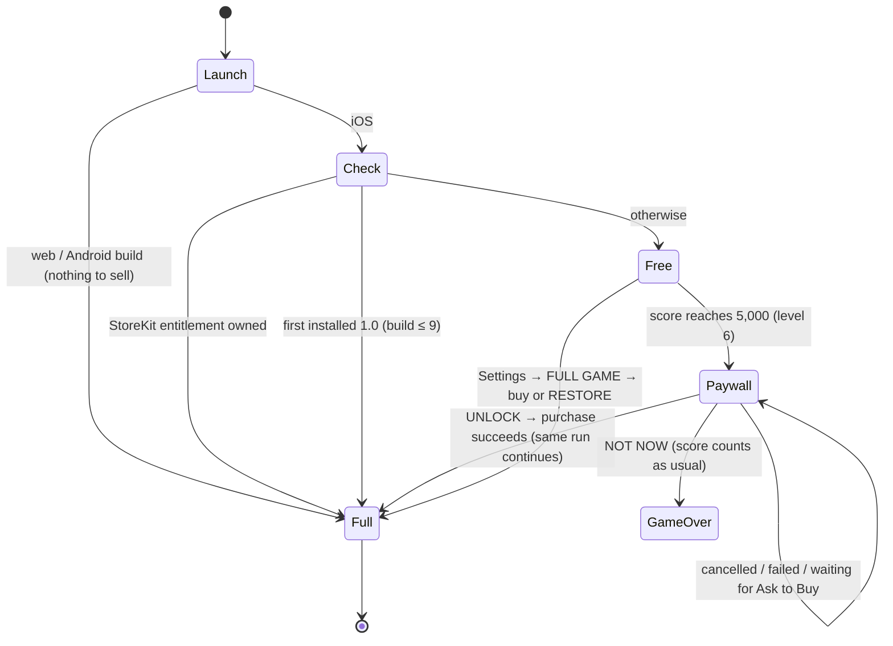

# DUAL

A two-thumb reflex arcade game: two dots, two lanes, endless gates. Built with
Phaser 3 + TypeScript + Vite. It ships as a web game / PWA at
<https://dual-game.pages.dev> and as an iOS app ("DUAL Mind") through a
Capacitor shell.

- [Run it](#run-it)
- [How the pieces fit](#how-the-pieces-fit)
- [Leaderboard](#leaderboard)
- [Database](#database)
- [Game Center achievements](#game-center-achievements)
- [Full Game unlock (in-app purchase)](#full-game-unlock-in-app-purchase)
- [Privacy](#privacy)
- [Releasing](#releasing)

Code-level conventions for AI agents and contributors live in
[AGENTS.md](AGENTS.md).

## Run it

```bash
bun install
bun run dev          # Vite on :3000 — uses the local (on-device) leaderboard
bun run build        # production web build → dist/
```

Dev-only switches:

| URL / env | Effect |
|---|---|
| `?paywall` | Fakes a locked iOS store in the browser: Settings shows FULL GAME and the paywall appears at level 6. The fake purchase succeeds after 0.7 s. |
| `VITE_LB_API=http://localhost:8788/api/scores` | Point `bun run dev` at a local Pages Function (`bunx wrangler pages dev dist --port 8788`). |
| `VITE_LB_API=local` | Force the on-device board in any build. |

`bun run dev` never writes to the live board unless `VITE_LB_API` says so.

## How the pieces fit



| Module | Job |
|---|---|
| `src/engine/Leaderboard.ts` | Global board client (Cloudflare), offline fallback to the on-device board, Game Center score mirror |
| `src/engine/Achievements.ts` | Decides which Game Center achievements a run earned and reports them |
| `src/engine/Store.ts` | Whether levels 6–10 are open; buy / restore through StoreKit |
| `functions/api/scores.ts` | The leaderboard API (validation, upsert, ranking) |
| `ios/App/App/*Plugin.swift` | App-local Capacitor plugins: Game Center and StoreKit |

## Leaderboard

One global board shared by both control modes. Each device is one row,
identified only by a random UUID it generates on first launch. Only a device's
best score is kept.



- **Best, not latest:** the client always sends `max(this run, device best)`,
  so runs played offline catch up on the next online game. The server keeps
  `MAX(old, new)` as well, so a worse run can never lower a row.
- **Names:** players set a nickname on the leaderboard screen; it's uppercased
  and stripped to `A–Z 0–9 space` (accents folded: "Lukáš" → `LUKAS`),
  3–14 characters, and checked against a leetspeak-aware profanity list on both
  client and server. Names are unique. A rename to a taken name gets
  `409 name_taken`. A score submitted under a taken or blocked name is still
  stored, under the device's previous name or `PLAYER` + the last 6 uid chars.
- **Cheat resistance** is best-effort: scores must be positive multiples of 10
  up to 1,000,000 and levels 1–10. Any client score can be forged in principle.
- **CORS is `*`** because the iOS app runs at `capacitor://localhost`. The API
  sets no cookies and needs no auth.

API:

| Method | Body / query | Result |
|---|---|---|
| `GET /api/scores` | `?uid=<uid>&limit=<1-100>` | `{ rows: [{rank,name,score,you}], you: {rank,name,score} \| null }`; `you` is filled when the caller is outside the top N |
| `POST /api/scores` | `{ uid, name, score, level }` | `{ ok, name }`, where `name` is the name actually stored |
| `PUT /api/scores` | `{ uid, name }` | `{ ok, name }`, or `409 name_taken` / `400 bad_name` |

## Database

Cloudflare D1 (SQLite), database `dual-scores`, bound to the Pages project as
`DB` in [`wrangler.toml`](wrangler.toml). Schema in [`migrations/`](migrations).



| Index | Purpose |
|---|---|
| `uid` primary key | One row per device; the upsert target |
| `idx_scores_score (score DESC)` | Top-N query |
| `idx_scores_name` unique | Rename check; stops two devices racing to one name |

How a write flows:



Working with it:

```bash
# first-time setup (creates the DB if needed, applies every migration)
./scripts/setup-leaderboard.sh

# apply a new migration to production
bunx wrangler d1 execute dual-scores --remote --file=migrations/000N_name.sql

# look at the board
bunx wrangler d1 execute dual-scores --remote \
  --command "SELECT name, score, level FROM scores ORDER BY score DESC LIMIT 20"

# remove one entry (privacy request) — needs the player's uid
bunx wrangler d1 execute dual-scores --remote --command "DELETE FROM scores WHERE uid = '<uid>'"
```

The Function deliberately logs no IP addresses. Free-tier D1 limits are far
above what this board needs.

## Game Center achievements

iOS only. Ten achievements worth 800 of Apple's 1,000 points. They were created
by [`scripts/setup-achievements.py`](scripts/setup-achievements.py); icons are
in [`store/achievements/`](store/achievements), drawn by `render.cjs`.

| ID (`dualmind.ach.…`) | Name | Earned by | Pts | Progress bar |
|---|---|---|---|---|
| `warmup` | Warm-up | Score 500 | 25 | yes |
| `level3` | Level 3 | Reach level 3 (2,000) | 50 | yes |
| `level5` | Level 5 | Reach level 5 (4,000) | 75 | yes |
| `level7` | Level 7 | Reach level 7 (6,000) | 100 | yes |
| `level10` | Level 10 | Reach level 10 (9,000) | 100 | yes |
| `beyond` | Beyond *(hidden)* | Score 10,000 | 100 | no, any progress would reveal it |
| `ghosthunter` | Ghost Hunter | Collect 5 ghosts in one run | 100 | no |
| `slowmotion` | Slow Motion | Grab bullet time 3 times in one run | 75 | no |
| `razorsedge` | Razor's Edge | 10 near misses in one run | 75 | no |
| `ambidextrous` | Ambidextrous | Reach level 5 in TWO HANDS | 100 | no |



- Reports go out **at the end of a run**, never mid-run, so Apple's banner
  never covers the play field.
- Level *n* starts at (n − 1) × 1,000 points; level achievements use the
  device's best score, so players who already had a high score get them on
  the first launch of 1.1.
- Game Center keeps the highest percentage ever reported. `localStorage`
  key `dual_ach` remembers what was sent, so nothing is re-sent needlessly.
- Near misses only count while the player holds no ghost charge (that's when
  the game detects them).
- Not signed in to Game Center? Nothing is reported or cached, and it is tried
  again next launch / run.

## Full Game unlock (in-app purchase)

DUAL is free with no ads and no tracking. Levels 1–5 are free in both control
modes; a one-time non-consumable purchase, `com.lukaschylik.dualmind.fullgame`
("Full Game", $0.95 / €0.95 / 25 Kč, Family Sharing on), opens levels 6–10.
The web build has no store and is always the full game. The product is created
by [`scripts/setup-full-game.py`](scripts/setup-full-game.py).



- **Paywall:** at the level 5→6 transition the run freezes under a sheet.
  UNLOCK opens Apple's purchase sheet; on success the paywall closes and the
  same run eases back to speed. NOT NOW ends the run like a crash would: best
  score saved, leaderboard and achievements updated, game-over card shown at
  LV 5/10.
- **1.0 players keep everything:** 1.0 shipped all ten levels for free. On
  iOS 16+ `AppTransaction.originalAppVersion` (the build number first
  installed) decides: ≤ 9 means a 1.0 player. This is trusted only in the
  production environment, because TestFlight and Xcode always report "1.0",
  which would hide the paywall from testers. On iOS 15, which has no
  AppTransaction, a player who already had a best score on the first launch
  of 1.1 counts as a 1.0 player.
- **Offline:** StoreKit's entitlement cache works offline, and `dual_full` in
  `localStorage` remembers an unlock in case a status call fails.
- **Ask to Buy / Family Sharing / other devices:** `Transaction.updates` is
  observed from launch. If an unlock arrives while the paywall is open, the
  run resumes by itself.
- **Restore:** Settings → FULL GAME → RESTORE runs `AppStore.sync()`.

`localStorage` keys used by the store: `dual_full` (cached unlock),
`dual_legacy_checked` (the iOS 15 first-launch check ran).

## Privacy

Anonymity is a design rule: no accounts, no email, no advertising ID, no ads,
no analytics. The leaderboard stores a random device UUID, a nickname, a best
score and a level; the server keeps no IP addresses. Game Center and in-app
purchases are handled by Apple under the player's Apple ID, and the app never
sees payment details. Policy: [`public/privacy/`](public/privacy/index.html).
Changing any of this means updating that page and the App Store privacy
answers together.

## Releasing

- **Web:** every push to `main` deploys to Cloudflare Pages, including
  `functions/`.
- **iOS:** [`scripts/publish-testflight.sh`](scripts/publish-testflight.sh)
  builds, archives and uploads with an App Store Connect API key
  (`ASC_KEY_PATH`, `ASC_KEY_ID`, `ASC_ISSUER_ID`). Bump
  `CURRENT_PROJECT_VERSION` (and `MARKETING_VERSION` for a new version) in
  `ios/App/App.xcodeproj` first.
- **App Store Connect setup scripts** (same env vars, safe to re-run; they use
  `scripts/asc.py`, which needs `pip install pyjwt cryptography`):
  - `python3 scripts/setup-achievements.py`
  - `python3 scripts/setup-full-game.py [--screenshot paywall.png]`
- New achievements and the in-app purchase go live only once they are attached
  to an app version that passes review.
